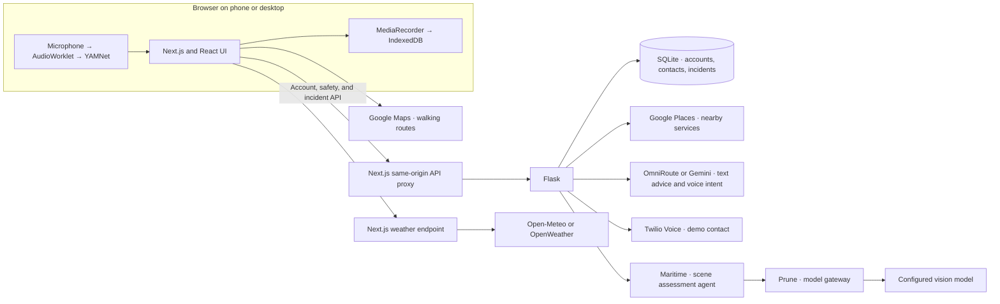
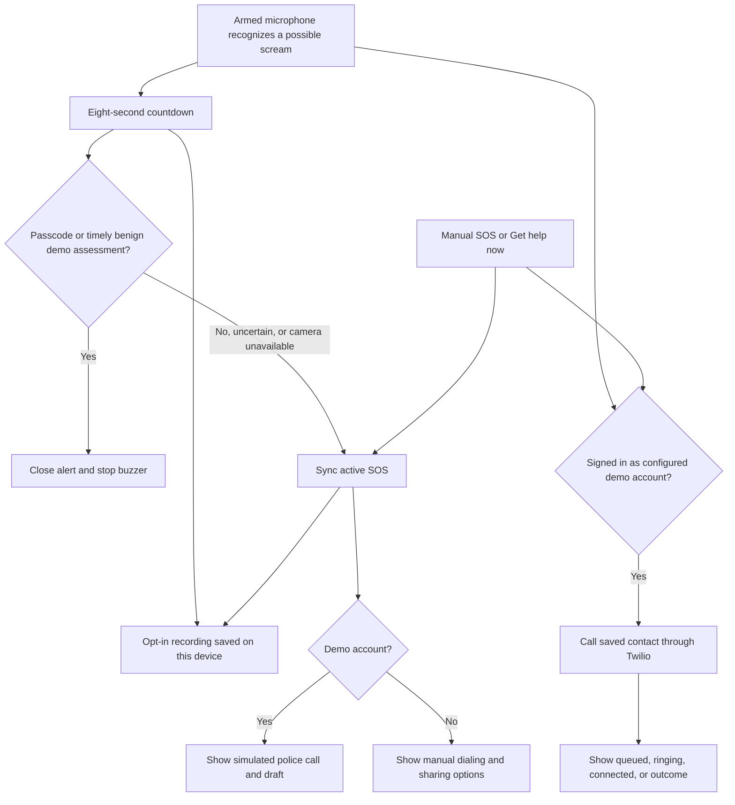
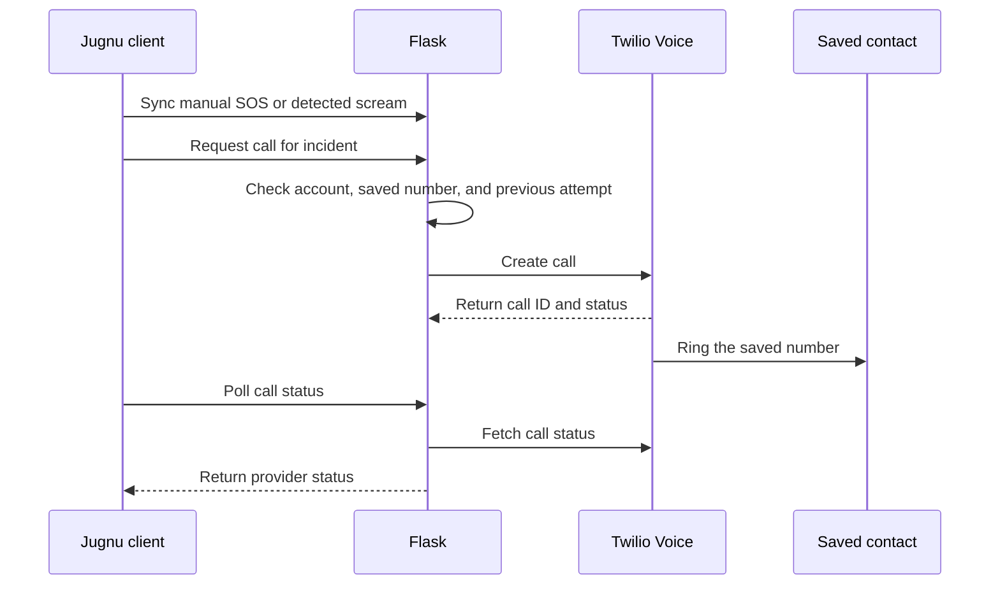
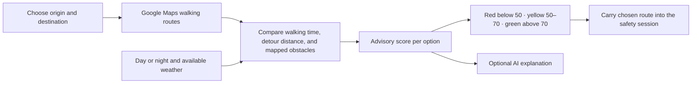

# Jugnu

**A personal safety companion for women on the move.**

Built for **Vihaan X** by **404 Name Not Found**.

Jugnu is a mobile-first web app for planning a walk, finding nearby help, and sharing an SOS with a trusted contact. The hackathon demo starts at DTU in Delhi. It combines live walking directions with advisory route comparisons, a microphone-based distress trigger, and a call to a configured contact.


## Try the demo

1. Open **Routes** and choose **Samaypur Badli Metro**, **Rithala Metro**, or **Japanese Park**. Compare the walking options Google Maps returns. Switch between daytime and nighttime, or ask AI to explain the suggested route.
2. Sign in, add a trusted contact, and set a four-digit SOS passcode. From a planned route, select **Start monitoring** to bring the map into an armed safety session.
3. With the demo account and Voice configured, **Start SOS** or a detected scream immediately requests a call to the saved demo contact. Audible mode starts the buzzer. A scream also opens an eight-second countdown for review. The passcode can dismiss the alert or silence the alarm after the call request. The police call appears as a labeled simulation.
4. Open **Community** to see the fictional DTU posts and submit a report. Use **Nearby help** to look up hospitals and police stations around a searched area or your current location.

| Walking routes | Safety session setup | Community feed |
| --- | --- | --- |
|  |  |  |

| Nearby help | SOS demo |
| --- | --- |
|  |  |

The SOS screenshot uses a simulated provider status. The live Twilio trial call was separately verified by the recipient. Community demo posts use fictional profiles and are labeled as examples.

## System architecture




## SOS flow



### Demo call sequence



The local browser plays the alarm and displays the police simulation. The server uses the saved demo destination and records one call request per incident. Trial mode uses Twilio’s hosted voice template. A standard account can play Jugnu’s own spoken message. [Twilio Voice trial settings](https://www.twilio.com/docs/usage/trials/try-out-voice) · [Twilio voice rules for India](https://www.twilio.com/en-us/guidelines/in/voice)

## Route comparison



The score compares known route features. Street lighting, pedestrian activity, and personal safety remain unverified.

## Maritime and Prune

Maritime hosts the private Python scene assessment agent. With camera consent, Jugnu can share a frame for an incident summary. In the demo, two frames can help assess a pending alert. The agent sends the request through Prune, which manages the vision provider key and can return a request receipt. Dark, missing, or inconclusive footage keeps the countdown active.

Live scene assessment requires a deployed Maritime agent, a Prune app key, and a vision provider configured in Prune. The scene assessment path was verified with mocked services. [Maritime custom agents](https://maritime.sh/docs/frameworks/custom) · [Prune integration](https://www.withprune.com/docs)

## Tech stack


| Layer | Technologies |
| --- | --- |
| Web app | Next.js 15, React 19, TypeScript, Tailwind CSS |
| Maps and context | Google Maps Routes and Places, Open-Meteo or OpenWeather |
| On-device audio | Web Audio API, AudioWorklet, MediaPipe Audio Tasks, YAMNet |
| Evidence | MediaRecorder, IndexedDB |
| Backend and auth | Python 3.12, Flask, SQLAlchemy, SQLite, hashed passwords and SOS passcodes |
| Text AI | OmniRoute with Groq GPT-OSS 20B and 120B fallback, or Gemini |
| Scene assessment | Maritime agent, Prune gateway, configurable vision model |
| Notifications | Twilio Voice for the demo contact, optional Twilio SMS |

## Run locally

Use Node.js 20 or later and Python 3.12. Copy [backend/.env.example](backend/.env.example) to `backend/.env` and [frontend/.env.example](frontend/.env.example) to `frontend/.env.local`.

```bash
cd backend
python -m venv venv
source venv/bin/activate
python -m pip install -r requirements.txt
python -m flask --app run run --host 127.0.0.1 --port 8000
```

On Windows PowerShell, activate the virtual environment with `.\venv\Scripts\Activate.ps1`.

```bash
cd frontend
npm ci --legacy-peer-deps
npm run dev
```

Open [localhost:3000](http://localhost:3000). Enable camera, microphone, and location from localhost or HTTPS. Follow the [live setup guide](docs/jugnu-live-setup.md) for Maps, OmniRoute or Gemini, Twilio, Maritime, and Prune. Use your own demo account and approved recipient. Keep credentials in local environment files.

